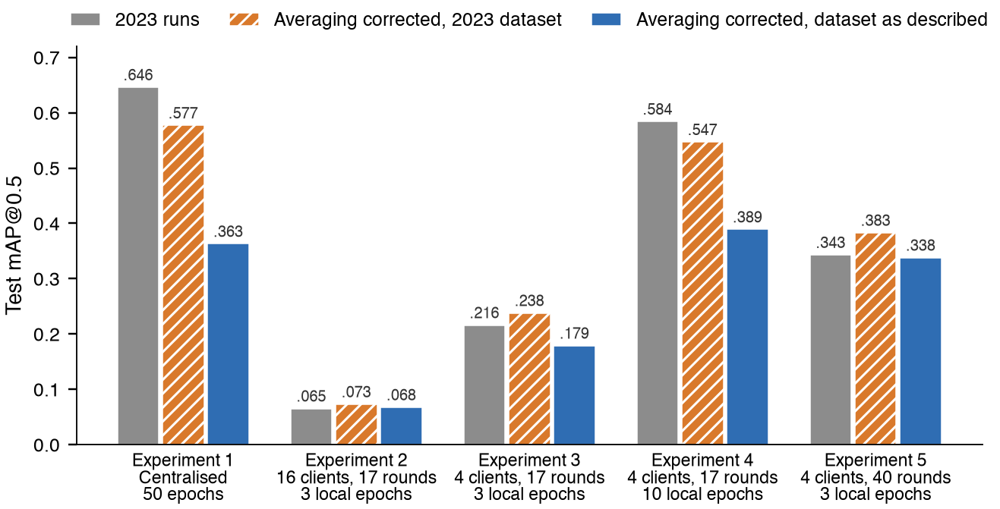
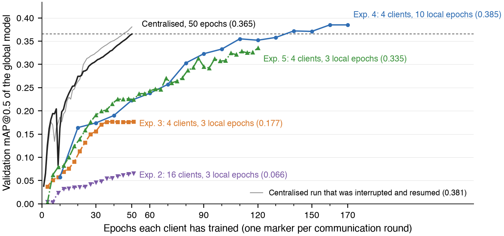

# fl-yolov7-road-signs

[](https://github.com/Bennett-hash/fl-yolov7-road-signs/actions/workflows/ci.yml)
[](LICENSE)

Code, data preparation and results for the paper

> Yizhen Bi. Empirical validation of federated learning with YOLO v7-tiny for
> road sign detection: A simulation-based comparative study. *Applied and
> Computational Engineering* 49, 92–101, 2024. Proceedings of the 4th
> International Conference on Signal Processing and Machine Learning
> (CONF-SPML 2024), Chicago, 15 January 2024.
> [doi:10.54254/2755-2721/49/20241067](https://doi.org/10.54254/2755-2721/49/20241067)

The paper also has a record at CNKI, under
[doi:10.26914/c.cnkihy.2024.074802](https://doi.org/10.26914/c.cnkihy.2024.074802).
Both DOIs identify the same paper; please cite the publisher's, the first.

**The paper's experiments contain errors, described below.** This repository
holds the 2023 notebooks that produced the paper's results, unchanged; a
corrected, tested implementation of its five experiments; code that rebuilds,
from the official GTSRB download, both the dataset the 2023 runs used and the
dataset the paper describes; and the results of all five experiments run again
with the errors corrected. [`CORRECTION.md`](CORRECTION.md) is the correction
note for the paper. It was written in November 2026 for the publisher, who has
not yet published a correction.

[中文说明](README.zh-CN.md)

## Read this first: errors in the paper's experiments

In November 2026, while preparing this code for release, I found two errors in
the paper's experiments. Both change its results.

1. **The federated experiments did not average the clients' models.** The
   function meant to compute the average stored it in a dictionary that was
   then discarded, and returned the first client's model unchanged. In
   Experiments 2 to 5, every round therefore carried on from client 1 alone:
   what was measured was one client training on its sixteenth (Experiment 2)
   or quarter (Experiments 3 to 5) of the data, not federated learning.
   [`original/README.md`](original/README.md) shows the line, and
   [`tests/test_averaging.py`](tests/test_averaging.py) shows the effect.
2. **The dataset was not prepared as the paper describes.** Section 2.1 of the
   paper converts each GTSRB image to PNG and labels it with its own region of
   interest. In the dataset the experiments used, each image was the GTSRB
   image cropped to its region of interest, and each box was the region of
   interest of a different image of the same class. Every label had the right
   class, but its box covered about three quarters of the width and height of
   an image that was all sign. All five experiments used this dataset.
   [Notes on the data](#notes-on-the-data) gives the details.

**The test set shares signs with the training set.** The paper says the data
were divided 8:1:1. Within each class, every tenth image went to validation
and another tenth to test. GTSRB records each physical sign as a track of 30
consecutive images, so each of its 1,307 tracks has 3 images in the validation
set, 3 in the test set and the rest in the training set. The test scores,
those of 2023 and those of the re-runs, therefore measure the detection of
signs that are also in the training set, not of signs a model has not seen.
The re-runs keep the 2023 split, so that they can be compared with the 2023
runs.

Five statements in the paper's text are also incorrect. It says that GTSRB has
40 classes; the runs used all 43. It says that the learning rate was a
constant 0.001; the runs used YOLOv7's default schedule, a warm-up followed by
a cosine fall from 0.01 towards 0.001, which starts again with every call of
`train.py`. It calls the input resolution, 64 × 64 pixels, the median
resolution of the training images; their median is 43 × 43. It gives the
centralised model's mAP as 0.642, which is its validation score; its test
score was 0.646. And it says that federated learning outperformed centralised
training in Experiment 4, which the 2023 runs did not show: 0.584 against
0.646 mAP@0.5 on the test set.

With both errors corrected, every score in the paper changes. Its finding that
accuracy depends strongly on the number of clients, local epochs and rounds
holds. Its statement that federated learning outperformed centralised training
does not: at the best setting the two are level (0.389 against 0.363 mAP@0.5).

The five experiments were run again with the corrected implementation twice:
on the 2023 dataset, with only the averaging corrected, and on the dataset
built as the paper describes (below, "the dataset as described").

## Results

Final test scores (mAP@0.5 on the 3,921 test images) of each experiment's
final model. "2023 runs" is what the 2023 notebooks printed; the paper itself
gives only 0.642 for Experiment 1 and "less than 0.1" for Experiment 2.

<!-- results-table:start -->
| Experiment | Setting | 2023 runs | Averaging corrected, 2023 dataset | Averaging corrected, dataset as described |
| --- | --- | --: | --: | --: |
| 1 | Centralised, 50 epochs | 0.646 | 0.577 | 0.363 |
| 2 | 16 clients, 17 rounds, 3 local epochs | 0.065 | 0.073 | 0.068 |
| 3 | 4 clients, 17 rounds, 3 local epochs | 0.216 | 0.238 | 0.179 |
| 4 | 4 clients, 17 rounds, 10 local epochs | 0.584 | 0.547 | 0.389 |
| 5 | 4 clients, 40 rounds, 3 local epochs | 0.343 | 0.383 | 0.338 |

| Experiment | Precision | Recall | mAP@0.5 | mAP@0.5:0.95 | mAP@0.5 relative to Experiment 1 |
| --- | --: | --: | --: | --: | --: |
| 1 | 0.676 | 0.455 | 0.363 | 0.291 | 100% |
| 2 | 0.507 | 0.306 | 0.068 | 0.049 | 19% |
| 3 | 0.409 | 0.488 | 0.179 | 0.140 | 49% |
| 4 | 0.597 | 0.476 | 0.389 | 0.323 | 107% |
| 5 | 0.378 | 0.539 | 0.338 | 0.276 | 93% |
<!-- results-table:end -->

Experiment 1 involves no averaging: its middle column is the 2023 experiment
run again in the 2026 environment. The second table gives all scores of the
re-run on the dataset as described.
[`results/`](results) has every experiment's score after each round, its
class-by-class test results and its confusion matrix, and
[`results/figures/`](results/figures) the figures as PDF and SVG.





### What the re-runs show

On the dataset as described, with the averaging corrected:

- **The score rises with the training each client does.** Sixteen clients
  with three local epochs barely learn (0.068). With four clients the score is
  0.179 after 51 epochs per client (Experiment 3), 0.338 after 120
  (Experiment 5) and 0.389 after 170 (Experiment 4). The paper's finding that
  accuracy depends strongly on the settings holds. Its statement that 40
  rounds "only yielded modest improvements" over 17 does not.
- **At equal training, three and ten local epochs a round do about the
  same.** After 120 epochs per client, ten local epochs a round (12 rounds)
  and three (40 rounds) give validation scores of 0.352 and 0.335; after 50
  epochs, 0.223 and 0.224. Experiment 4 ends higher than Experiment 5 because
  its clients trained for 170 epochs, not 120. On the 2023 dataset ten local
  epochs are ahead at equal training (0.470 against 0.374 after 120 epochs).
- **Experiment 4 reaches the score of centralised training; it does not
  exceed it.** The paper says Experiment 4 "outperformed the centralized
  approach". The 2023 runs did not show that (0.584 against 0.646). In the
  re-runs the two are level: 0.389 against 0.363 on the dataset as described,
  and 0.547 against 0.577 on the 2023 dataset. Two runs of the same settings
  differ by as much (see below). Between them, Experiment 4's four clients did
  3.4 times the computation of the centralised run: 170 epochs each on a
  quarter of the data, against 50 epochs on all of it. The centralised run's
  validation score was still rising when its 50 epochs ended (0.334 at epoch
  40, 0.365 at epoch 50).
- **Each client returns its best epoch on the shared validation set, often
  the first.** As in 2023, a client returns the `best.pt` that YOLOv7's
  `train.py` keeps: the local epoch that scored highest on the validation set.
  All clients share that set, which a client in a real federation would not
  have. In the rounds whose client records were kept, the epoch returned was
  the first local epoch in 30 of 56 client runs of Experiment 4, 74 of 116 of
  Experiment 5, 21 of 68 of Experiment 3 and 52 of 272 of Experiment 2. In
  those runs the later local epochs did not enter the average.
- **Three local epochs are all warm-up.** Every round starts `train.py`
  afresh, and its learning-rate warm-up lasts three epochs or 1,000
  iterations, whichever is longer. With three local epochs a client's whole
  round is warm-up: the weights' learning rate peaks at about half of its
  nominal 0.01 with four clients, and at about a fifth with sixteen (123
  batches an epoch). Ten local epochs leave seven after the warm-up. A
  comparison of three and ten local epochs is therefore also a comparison of
  learning rates.
- **Scores are lower on the dataset as described than on the 2023 dataset**,
  in every experiment (centralised: 0.363 against 0.577 in the same
  environment). The boxes are distributed alike in the two: centred, and about
  three quarters of the image wide and high. In the 2023 dataset the image is
  the sign alone and the box covers its middle. In the dataset as described
  the image has a border of background and the box is the sign, which is
  smaller at 64 pixels. Why the scores are lower was not tested.
- **What averaging adds over one client training alone was not tested.** The
  2023 runs were in effect one client training alone on its quarter or
  sixteenth of the data. On the 2023 dataset the same experiments with the
  averaging corrected come within 0.04 of them. But the two sets of runs were
  made in different environments, in which the centralised experiment, which
  involves no averaging, scored 0.646 and 0.577, and no single-client run was
  made in 2026.

### Variation between runs

Each experiment was run once, except the centralised one, so there are no
error bars. Three comparisons show how much runs of the same settings differ:

- Experiments 3 and 5 are the same procedure for their first 17 rounds, with
  the same clients and seed. After round 17 the global model's validation
  mAP@0.5 was 0.177 in Experiment 3 and 0.224 in Experiment 5 on the dataset
  as described, and 0.236 and 0.258 on the 2023 dataset.
- The centralised run on the dataset as described was made twice: 0.381 and
  0.363 on the test set.
- The centralised run on the 2023 dataset exists three times: 0.646 in 2023,
  and 0.577 and 0.531 in the re-runs.

Runs of the same settings thus differed by 0.02 to 0.05 within the re-runs,
and by 0.07 to 0.12 between 2023 and the re-runs. Differences of that size
between experiments should not be read as effects of the settings.

The first centralised re-run on each dataset was stopped by Colab and
continued with `train.py --resume` (twice on the dataset as described, four
times on the 2023 dataset). Because the interruptions might have cost
accuracy, I ran each again from start to finish. These repeats were started
after the interrupted runs had ended and their scores were known; I decided
to report the repeats before they ended. The interrupted run came out lower on
the 2023 dataset (0.531 against 0.577) and higher on the dataset as described
(0.381 against 0.363), so no effect of the interruptions can be told apart
from ordinary variation. Both are in [`results/`](results), the interrupted
ones as `exp1-interrupted`.

The centralised re-run on the 2023 dataset, 0.577, is below the 0.646 of 2023,
with the same data and training arguments. The two runs differ in software
(PyTorch 2.14 against 2.0.1), in the number of data-loading processes and in
sharing a GPU. Which of these matters, if any, was not established. The
evaluation is not the cause: the five final models of 2023, scored again with
this code, give the test mAP of their notebooks to within 0.001 (see
[How this code differs](#how-this-code-differs-from-the-2023-notebooks)).

### How the re-runs were made

The re-runs were made on Google Colab in November 2026, on NVIDIA L4 and Tesla
T4 GPUs, with the clients of a round training at the same time and several
experiments sharing a GPU. Their recorded times are therefore not comparable
with the paper's. Colab ended several sessions mid-run. A federated experiment
then carried on from its last finished round on another machine, which is the
step the procedure takes between any two rounds. Every round's global score
is recorded for every experiment. The clients' own per-epoch records survive
only for the rounds run on the machine an experiment finished on
(`client_records_rounds` in [`results/summary.csv`](results/summary.csv)), and
each `settings.json` describes the session its run ended in.

## What is here

```
original/              the 2023 Colab notebooks, unchanged, with their outputs
  notebooks/           one per experiment
  results/             what they saved: confusion matrices, curves, logs
src/fedyolo/           the corrected implementation
  run.py               runs one experiment, resuming after an interruption
  averaging.py         averages YOLOv7 checkpoints (the corrected function)
  original.py          the 2023 function, word for word, for comparison
  partition.py         divides the training images among clients
  data.py              builds the dataset from the official GTSRB download
  gtsrb_2023.csv       the 2023 split and labels, one row per image
  experiments.py       the paper's Table 2
  yolo.py, compat.py   run YOLOv7's own train.py and test.py
colab/                 scripts for running the experiments on Google Colab
tools/                 collect results from the run archives, draw the figures
results/               the re-run experiments: metrics, confusion matrices, figures
tests/                 run on any computer, no GPU needed
CORRECTION.md          the correction note for the paper
CITATION.cff           how to cite the paper
README.zh-CN.md        this file in Chinese
```

The [release](https://github.com/Bennett-hash/fl-yolov7-road-signs/releases)
holds what is too large for the repository: one archive per run, with its
logs, its scores after every round, the clients' records and its final model;
and the final models of the five 2023 runs.

## Running it

### Requirements

- Python 3.10 or newer, PyTorch, and the packages YOLOv7 uses: OpenCV,
  NumPy, SciPy, pandas, Matplotlib, seaborn, PyYAML, tqdm, TensorBoard.
- [WongKinYiu/yolov7](https://github.com/WongKinYiu/yolov7) at commit
  `84932d70fb9e2932d0a70e4a1f02a1d6dd1dd6ca`, the version the 2023 runs used,
  and its `yolov7-tiny.pt` weights.
- A CUDA GPU for the experiments. The paper used a Tesla T4.

```bash
git clone https://github.com/Bennett-hash/fl-yolov7-road-signs.git
cd fl-yolov7-road-signs
pip install -e .
git clone https://github.com/WongKinYiu/yolov7.git third_party/yolov7
git -C third_party/yolov7 checkout 84932d70fb9e2932d0a70e4a1f02a1d6dd1dd6ca
curl -L -o third_party/yolov7/yolov7-tiny.pt https://github.com/WongKinYiu/yolov7/releases/download/v0.1/yolov7-tiny.pt
```

The SHA-256 of `yolov7-tiny.pt` is
`0fa1423606133c06362ec716029dade1169d5631e83195b75d8efa66d2ee0b77`.
YOLOv7's `requirements.txt` asks for NumPy below 1.24, which no longer
installs on current Python. Install the packages above without that limit;
`fedyolo.compat` restores the few NumPy names YOLOv7 still uses.

### Data

```bash
python -m fedyolo.data --out data/gtsrb-yolo
```

This needs OpenCV (`pip install -e ".[data]"` installs it). It downloads the
GTSRB training set from its official archive (276 MB, checked against a
SHA-256), converts every image to PNG, labels it with its
own region of interest using Equation 1 of the paper, and divides it exactly
as the 2023 runs did: 31,367 training, 3,921 validation and 3,921 test images,
80/10/10 within every class. Within a class, every tenth image is a validation
image and another tenth a test image, so every GTSRB track, and with it every
physical sign, has images in all three sets.

To rebuild the dataset the 2023 runs used:

```bash
python -m fedyolo.data --out data/gtsrb-yolo-2023 --as-2023
```

It is identical, image for image and label for label, to the one the
notebooks unpacked. Both commands finish by checking a digest of what they
wrote against the dataset the results here were run on.

GTSRB's authors do not state a licence for redistributing the images, so this
repository does not include them, in either form. It holds only the split, the
2023 labels and the code that rebuilds both datasets from the official
download.

### Experiments

```bash
python -m fedyolo.run exp4 --yolov7 third_party/yolov7 --data data/gtsrb-yolo --out runs
```

`exp1` to `exp5` are the experiments of the paper's Table 2. Each writes to
`runs/<experiment>/`: the clients' training logs, every round's global model,
`metrics.csv` with the validation score after every round and the final test
score, and the final test's confusion matrix. Running the same command again
after an interruption picks up where it stopped. `--parallel 4` trains the
clients of a round at the same time, which changes nothing but the time it
takes. `--tag` adds a name to the output folder, to keep runs on different
datasets apart. `--averaging original` runs the 2023 function instead of the
corrected one.

[`colab/`](colab) has the scripts used to run the experiments on Google
Colab with the [Colab CLI](https://github.com/googlecolab/google-colab-cli).

### Results and figures from the run archives

```bash
pip install -e ".[figures]"
gh release download v1.0.1 --repo Bennett-hash/fl-yolov7-road-signs --pattern "*-exp*.tar.gz" --dir archives
python tools/collect_results.py archives
python tools/make_figures.py
```

This rewrites [`results/`](results), the tables in this file and in
`CORRECTION.md`, and the figures, from the archives of the runs.

### Tests

```bash
pip install -e ".[dev]"
pytest
```

## How this code differs from the 2023 notebooks

Every training run is still a call to YOLOv7's own `train.py` with the
arguments the notebooks used (`--img 64 --batch 16 --cache`, YOLOv7's default
hyperparameters, starting from `yolov7-tiny.pt`), and every client still
returns the `best.pt` that `train.py` keeps: the weights, as YOLOv7's moving
average, of the local epoch that scored highest on the validation set. Apart
from that:

- **Averaging.** Every floating-point tensor of the clients' models is
  averaged, BatchNorm statistics included. The clients hold equal shares of
  the data, so the plain mean is also the sample-weighted mean of federated
  averaging.
- **Client data.** The notebooks divided the images in the order the file
  system listed them, which was not recorded. Here they are shuffled with a
  fixed seed and then divided, so every run gets the same clients.
- **Evaluation.** The global model is also scored on the validation set after
  every round, so the results include learning curves. The final test is the
  one the notebooks ran.
- **Confusion matrices.** YOLOv7 at this commit counts a sign of one class
  detected as another in the transposed cell: its own plot, which is what the
  paper's Figures 2 to 6 are, labels rows "Predicted" and columns "True", but
  holds those cells the other way round. The matrices in
  [`results/`](results) and the figures drawn from them have the predicted
  class in rows and the true class in columns throughout. As in YOLOv7, they
  count detections with a confidence of at least 0.25, and count a detection
  that matches no sign only in images where some detection matched a sign.
- **Environment.** The re-runs used Python 3.13, PyTorch 2.14 and NumPy 2 on
  NVIDIA L4 and Tesla T4 GPUs; the 2023 runs used Python 3.10 and PyTorch
  2.0.1 on a Tesla T4. As a check on the evaluation, the five final models of
  2023 were scored again in November 2026 with this code, on a CPU with
  PyTorch 2.15 and NumPy 2.5. Their test mAP@0.5 came out as 0.646, 0.065,
  0.216, 0.583 and 0.343, against 0.646, 0.065, 0.216, 0.584 and 0.343 in the
  notebooks, and their mAP@0.5:0.95 within 0.001. Precision and recall, which
  YOLOv7 reads at a single confidence, moved by up to 0.05.
- **Housekeeping.** Runs can resume, clients of a round can train at the same
  time, and YOLOv7's label caches are written once before parallel clients
  start.

## Notes on the data

The 2023 runs used GTSRB as distributed on
[Kaggle](https://www.kaggle.com/datasets/meowmeowmeowmeowmeow/gtsrb-german-traffic-sign),
which I converted to YOLO format with a script in August 2023. The class names
were taken from the ReadMe of the related German Traffic Sign Detection
Benchmark (GTSDB). I did not keep the script; what it did can be read off its
output, which was compared with the official GTSRB files image by image:

- Each of the 39,209 images is, pixel for pixel, the corresponding GTSRB
  training image cropped to its region of interest. The file
  `<class>_<k>.png` is the k-th image of that class in GTSRB's order.
- Every label has the right class. Its box is the region of interest of a
  GTSRB image of the same class, normalised by that image's size, but in all
  but 78 labels not of the image it labels. And since the image is already
  cropped to the sign, the right box would have been the whole image.
- The split takes, within each class in GTSRB's order, every tenth image for
  validation (k = 4, 14, 24, …) and another tenth for test (k = 6, 16, 26, …).
  GTSRB's training images come in tracks of 30 consecutive images of one
  physical sign (one track has 29), so each of the 1,307 tracks has 3 images
  in the validation set, 3 in the test set and the rest in the training set,
  and every test image has its two neighbours in its track in the training
  set. The dataset as described keeps this split.

GTSRB's images hold the sign in the middle, with a border of a tenth of the
sign's size and at least 5 pixels. Their regions of interest are therefore
centred and cover about three quarters of the width and height of their images
(median 76%). The 2023 labels, taken from other images of the same class, have
the same distribution.

`src/fedyolo/gtsrb_2023.csv` records, for every image, its split, the GTSRB
file it came from, and its 2023 label. `fedyolo.data` uses it to rebuild either
dataset from the official download, so no images are redistributed here.

## Citation

Please cite the paper and, once the publisher has published it, its
correction. [`CITATION.cff`](CITATION.cff) has the details.

## Licence

The code is under the GNU General Public License v3.0, the licence of YOLOv7,
which it runs and whose checkpoints it loads. The paper is published under
CC BY 4.0. GTSRB comes from the Institut für Neuroinformatik,
Ruhr-Universität Bochum. Its authors state no licence for it; it is
downloaded from its official archive and not included here.

## Acknowledgements

- The German Traffic Sign Recognition Benchmark: J. Stallkamp, M. Schlipsing,
  J. Salmen and C. Igel, *The German Traffic Sign Recognition Benchmark: A
  multi-class classification competition*, IJCNN 2011, 1453–1460; and *Man vs.
  computer: Benchmarking machine learning algorithms for traffic sign
  recognition*, Neural Networks 32, 323–332, 2012. Its home page is
  [houbensebastian/GermanTrafficSignBenchmarks](https://github.com/houbensebastian/GermanTrafficSignBenchmarks).
- YOLOv7: C.-Y. Wang, A. Bochkovskiy and H.-Y. M. Liao, CVPR 2023, and
  [WongKinYiu/yolov7](https://github.com/WongKinYiu/yolov7).
- I used [Claude Code](https://claude.com/product/claude-code) (Anthropic) in
  November 2026 to check the 2023 notebooks and data, to write the corrected
  code, to run the experiments again and to draft this README and the
  correction note. I have checked the results and the text, and am responsible
  for them.

## Contact

Yizhen Bi, [ORCID 0009-0005-5639-5771](https://orcid.org/0009-0005-5639-5771).
For questions about the code or the data, please open an issue.
