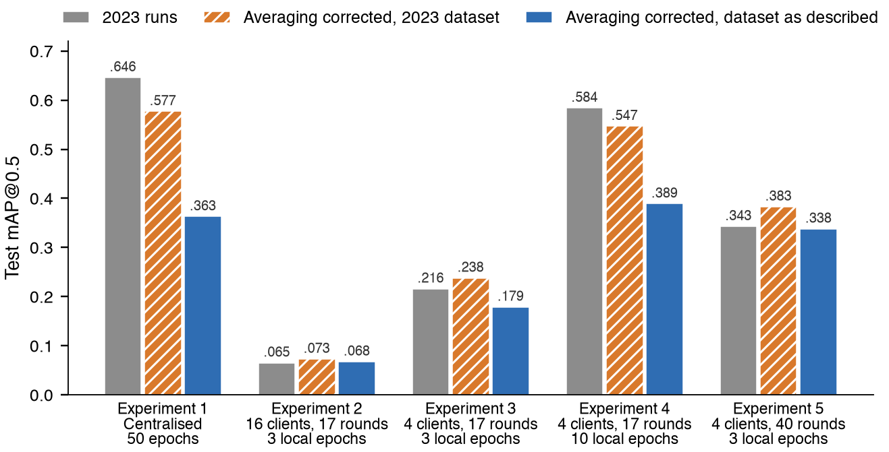
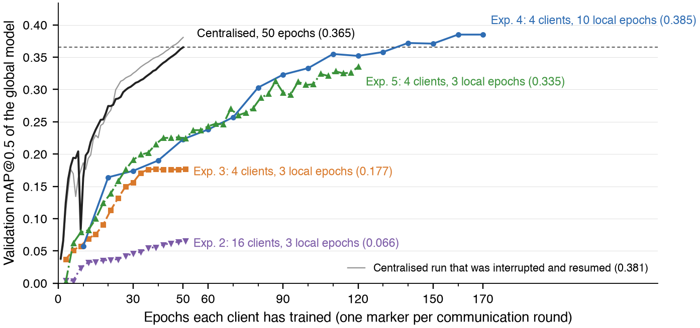

# fl-yolov7-road-signs

[](https://github.com/Bennett-hash/fl-yolov7-road-signs/actions/workflows/ci.yml)
[](LICENSE)

这是下面这篇论文的代码、数据准备和结果：

> Yizhen Bi. Empirical validation of federated learning with YOLO v7-tiny for
> road sign detection: A simulation-based comparative study. *Applied and
> Computational Engineering* 49, 92–101, 2024. 第四届信号处理与机器学习国际会议
> （CONF-SPML 2024）论文集，芝加哥，2024 年 1 月 15 日。
> [doi:10.54254/2755-2721/49/20241067](https://doi.org/10.54254/2755-2721/49/20241067)

论文在中国知网也有一条记录，知网另给了它一个 DOI：[10.26914/c.cnkihy.2024.074802](https://doi.org/10.26914/c.cnkihy.2024.074802)。两个 DOI 对应同一篇论文，引用请用上面出版社的 DOI。

**论文的实验有错误，详见下文。** 这个仓库里有：得出论文结果的 2023 年的笔记本，原样未改；论文五个实验的一份修正过、经过测试的实现；从 GTSRB 官方下载重建数据集的代码，既能重建 2023 年的运行所用的数据集，也能重建论文描述的数据集；以及改正错误之后五个实验全部重跑的结果。[`CORRECTION.md`](CORRECTION.md)（英文）是论文的更正说明。这份更正说明是 2026 年 11 月为出版社写的，出版社还没有发表更正。

[English](README.md)

## 请先读这一节：论文实验中的错误

2026 年 11 月，我在整理这份代码准备公开时，发现论文的实验有两处错误。两处错误都会改变论文的结果。

1. **联邦实验没有对各客户端的模型求平均。** 本应求平均的那个函数把平均值存进了一个字典，随后这个字典就被丢弃了；函数返回的是第一个客户端的模型，原封未动。所以在实验 2 到 5 里，每一轮都只从客户端 1 的模型接着往下训练：测到的是一个客户端用它那十六分之一（实验 2）或四分之一（实验 3 到 5）的数据训练，不是联邦学习。[`original/README.md`](original/README.md)（英文）指出了出错的那一行，[`tests/test_averaging.py`](tests/test_averaging.py) 演示了这个错误的后果。
2. **数据集没有按论文所述的方式准备。** 论文 2.1 节的做法是把每张 GTSRB 图片转成 PNG，并用这张图片自己的感兴趣区域（ROI）作为标注。实验用的数据集里，每张图片是沿 ROI 裁剪过的 GTSRB 图片，每个框是同类别另一张图片的 ROI。每个标注的类别都是对的，但图片整张都是路标，标注框却覆盖图片宽和高的大约四分之三。五个实验用的都是这个数据集。细节见[关于数据的说明](#关于数据的说明)。

**测试集和训练集里有相同的路标。** 论文说数据按 8:1:1 划分。在每个类别内部，每十张图中有一张进了验证集，另有一张进了测试集。GTSRB 对每个实物路标连续拍 30 张图，称为一条轨迹（track），所以 GTSRB 的 1,307 条轨迹中，每一条都有 3 张图在验证集，3 张在测试集，其余在训练集。因此，2023 年的测试分数和重跑的测试分数，测的都是模型检测训练集里也有的路标，不是检测模型没见过的路标。重跑沿用了 2023 年的划分，以便和 2023 年的运行比较。

论文正文里还有五处说法不正确。论文说 GTSRB 有 40 个类别，而运行用的是全部 43 个类别。论文说学习率固定为 0.001，而运行用的是 YOLOv7 的默认调度：先预热，再按余弦曲线从 0.01 降向 0.001，这个调度每调用一次 `train.py` 都从头开始。论文把输入分辨率 64 × 64 像素称为训练图片分辨率的中位数，而训练图片的中位数是 43 × 43。论文给出的集中式模型的 mAP 是 0.642，这是这个模型的验证集分数；它在测试集上的分数是 0.646。论文还说实验 4 中联邦学习超过了集中式训练，2023 年的运行并不支持这一点：测试集上的 mAP@0.5，实验 4 是 0.584，集中式训练是 0.646。

两处错误都改正之后，论文里的每一个分数都变了。论文发现精度在很大程度上取决于客户端数、本地 epoch 数和轮数，这一发现成立。论文说联邦学习超过了集中式训练，这一说法不成立：在最好的设置下，两者相当（mAP@0.5 是 0.389 和 0.363）。

我用修正后的实现把五个实验重跑了两遍。一遍用 2023 年的数据集，只修正了求平均。另一遍用的数据集按论文的描述构建，下文称为“按论文所述构建的数据集”。

## 结果

下表是每个实验最后得到的模型在最终测试中的分数（3,921 张测试图片上的 mAP@0.5）。“2023 年的结果”是 2023 年的笔记本打印出来的分数；论文本身只给出了实验 1 的 0.642 和实验 2 的“less than 0.1”。

<!-- results-table:start -->
| 实验 | 设置 | 2023 年的结果 | 平均已修正，2023 年数据集 | 平均已修正，按论文所述构建的数据集 |
| --- | --- | --: | --: | --: |
| 1 | 集中式，50 个 epoch | 0.646 | 0.577 | 0.363 |
| 2 | 16 个客户端，17 轮，每轮 3 个本地 epoch | 0.065 | 0.073 | 0.068 |
| 3 | 4 个客户端，17 轮，每轮 3 个本地 epoch | 0.216 | 0.238 | 0.179 |
| 4 | 4 个客户端，17 轮，每轮 10 个本地 epoch | 0.584 | 0.547 | 0.389 |
| 5 | 4 个客户端，40 轮，每轮 3 个本地 epoch | 0.343 | 0.383 | 0.338 |

| 实验 | 精确率 | 召回率 | mAP@0.5 | mAP@0.5:0.95 | mAP@0.5 与实验 1 之比 |
| --- | --: | --: | --: | --: | --: |
| 1 | 0.676 | 0.455 | 0.363 | 0.291 | 100% |
| 2 | 0.507 | 0.306 | 0.068 | 0.049 | 19% |
| 3 | 0.409 | 0.488 | 0.179 | 0.140 | 49% |
| 4 | 0.597 | 0.476 | 0.389 | 0.323 | 107% |
| 5 | 0.378 | 0.539 | 0.338 | 0.276 | 93% |
<!-- results-table:end -->

实验 1 不涉及求平均：表中实验 1 那一行的中间一列，是 2023 年的实验在 2026 年的环境里重跑一次的结果。第二张表是在按论文所述构建的数据集上重跑的全部分数。[`results/`](results) 里有每个实验每一轮之后的分数、分类别的测试结果和混淆矩阵，[`results/figures/`](results/figures) 里有 PDF 和 SVG 格式的图。





### 重跑说明了什么

在按论文所述构建的数据集上，修正了求平均之后：

- **分数随每个客户端的训练量上升。** 16 个客户端、每轮 3 个本地 epoch 时，模型几乎学不到东西（0.068）。4 个客户端时，每个客户端训练 51 个 epoch 后分数是 0.179（实验 3），120 个 epoch 后是 0.338（实验 5），170 个 epoch 后是 0.389（实验 4）。论文发现精度在很大程度上取决于设置，这一发现成立。论文说 40 轮比 17 轮“only yielded modest improvements”，这一说法不成立。
- **训练量相同时，每轮 3 个和每轮 10 个本地 epoch 的效果差不多。** 每个客户端训练 120 个 epoch 后，每轮 10 个本地 epoch（12 轮）和每轮 3 个（40 轮）的验证集分数是 0.352 和 0.335；训练 50 个 epoch 后是 0.223 和 0.224。实验 4 最后的分数比实验 5 高，是因为实验 4 的客户端训练了 170 个 epoch，而不是 120 个。在 2023 年的数据集上，训练量相同时每轮 10 个本地 epoch 领先（训练 120 个 epoch 后，每轮 10 个是 0.470，每轮 3 个是 0.374）。
- **实验 4 达到了集中式训练的分数，没有超过。** 论文说实验 4“outperformed the centralized approach”。2023 年的运行并不支持这一点（实验 4 是 0.584，集中式训练是 0.646）。在重跑中两者相当：在按论文所述构建的数据集上是 0.389 和 0.363，在 2023 年的数据集上是 0.547 和 0.577。同样设置的两次运行之间，也会相差这么多（见下文）。实验 4 的 4 个客户端加起来，计算量是集中式的那次运行的 3.4 倍：每个客户端在四分之一的数据上训练 170 个 epoch，集中式的那次运行在全部数据上训练 50 个 epoch。集中式的那次运行在 50 个 epoch 结束时，验证集分数还在上升（第 40 个 epoch 是 0.334，第 50 个 epoch 是 0.365）。
- **每个客户端交回的是它在共用验证集上最好的那个 epoch，常常是第一个。** 和 2023 年一样，客户端交回的是 YOLOv7 的 `train.py` 保留的 `best.pt`，也就是在验证集上得分最高的那个本地 epoch。所有客户端共用这个验证集，而在真实的联邦学习里，客户端不会有这样一个共用的验证集。在保留了客户端记录的那些轮次里，交回第一个本地 epoch 的情况是：实验 4 的 56 次客户端运行中有 30 次，实验 5 的 116 次中有 74 次，实验 3 的 68 次中有 21 次，实验 2 的 272 次中有 52 次。在这些运行中，后面的本地 epoch 没有进入平均。
- **3 个本地 epoch 全是预热。** 每一轮都重新启动 `train.py`，而 `train.py` 的学习率预热持续 3 个 epoch 或 1,000 次迭代，取较长者。每轮 3 个本地 epoch 时，客户端的整轮训练都是预热：4 个客户端时，权重的学习率最高约为标称值 0.01 的一半；16 个客户端时（每个 epoch 123 个批次），最高约为五分之一。每轮 10 个本地 epoch 时，预热之后还剩 7 个 epoch。因此，比较 3 个和 10 个本地 epoch，也是在比较不同的学习率。
- **在按论文所述构建的数据集上，分数比在 2023 年的数据集上低**，每个实验都是这样（集中式训练在同一环境下是 0.363 和 0.577）。两个数据集里框的分布一样：都在图片中央，宽和高都约为图片的四分之三。2023 年的数据集里，图片只有路标，框盖住路标的中间部分。按论文所述构建的数据集里，图片四周有一圈背景，框就是路标，在 64 像素的图片里路标更小。分数为什么更低，没有测试过。
- **和一个客户端单独训练相比，求平均能多带来什么，没有测试过。** 2023 年的运行实际上是一个客户端用它那四分之一或十六分之一的数据单独训练。在 2023 年的数据集上，修正了求平均之后，同样的实验和 2023 年的运行相差都在 0.04 以内。但这两组运行是在不同的环境里做的：在这两个环境里，不涉及求平均的集中式实验分别得到 0.646 和 0.577；而且 2026 年没有做过单个客户端的运行。

### 运行之间的差异

除集中式训练外，每个实验只跑了一次，所以没有误差棒。下面三组对比说明了同样设置的运行之间相差多少：

- 实验 3 和实验 5 的前 17 轮是同一个流程，客户端和随机种子也相同。第 17 轮之后全局模型的验证集 mAP@0.5，在按论文所述构建的数据集上，实验 3 是 0.177，实验 5 是 0.224；在 2023 年的数据集上是 0.236 和 0.258。
- 在按论文所述构建的数据集上，集中式训练跑了两次，测试集分数是 0.381 和 0.363。
- 在 2023 年的数据集上，集中式训练有三次运行：2023 年是 0.646，重跑是 0.577 和 0.531。

所以，同样设置的运行之间，在重跑内部相差 0.02 到 0.05，在 2023 年和重跑之间相差 0.07 到 0.12。实验之间这么大的差距，不应当解读为设置带来的效果。

每个数据集上的第一次集中式重跑都被 Colab 中断过，之后用 `train.py --resume` 接着跑（按论文所述构建的数据集上 2 次，2023 年的数据集上 4 次）。中断可能会损失精度，所以我在每个数据集上都把集中式训练从头到尾重新跑了一次。这两次重复运行是在被中断的运行结束、分数已经知道之后开始的；在重复运行结束之前，我就决定报告重复运行的结果。被中断的运行在 2023 年的数据集上分数更低（0.531 和 0.577），在按论文所述构建的数据集上更高（0.381 和 0.363），所以中断的影响无法和运行之间通常的差异区分开。两组结果都在 [`results/`](results) 里，被中断的运行放在 `exp1-interrupted`。

在 2023 年的数据集上，集中式重跑得到 0.577，低于 2023 年的 0.646，而两次运行的数据和训练参数都相同。两次运行的不同在于软件（PyTorch 2.14 和 2.0.1）、读取数据的进程数，以及是否共用 GPU。其中哪一项起了作用，或者都没有起作用，没有查明。原因不在评估：2023 年的五个最终模型用这份代码重新评分，得到的测试集 mAP 和各自笔记本里的相差不超过 0.001（见[这份代码有什么不同](#这份代码和-2023-年的笔记本有什么不同)）。

### 重跑是怎么做的

重跑是 2026 年 11 月在 Google Colab 上做的，用的是 NVIDIA L4 和 Tesla T4 GPU，同一轮的客户端同时训练，几个实验共用一块 GPU。因此，重跑记录下来的耗时不能和论文里的耗时比较。Colab 在运行中途结束过几次会话。这时联邦实验会在另一台机器上从上一个完成的轮次接着跑，流程在任意两轮之间做的也是这一步。每个实验每一轮的全局分数都有记录。客户端自己逐个 epoch 的记录，只有在实验最后跑完的那台机器上运行的轮次才保留了下来（见 [`results/summary.csv`](results/summary.csv) 里的 `client_records_rounds`）；每个 `settings.json` 描述的是对应运行结束时所在的会话。

## 仓库里有什么

```
original/              2023 年的 Colab 笔记本，原样保留，带当时的输出
  notebooks/           每个实验一个
  results/             笔记本保存的结果：混淆矩阵、曲线、日志
src/fedyolo/           修正后的实现
  run.py               运行一个实验，中断后可以续跑
  averaging.py         对 YOLOv7 的权重求平均（修正后的函数）
  original.py          2023 年的函数，一字未改，用于对照
  partition.py         把训练图片分给各个客户端
  data.py              从 GTSRB 官方下载构建数据集
  gtsrb_2023.csv       2023 年的划分和标注，每张图一行
  experiments.py       论文的表 2
  yolo.py, compat.py   调用 YOLOv7 自己的 train.py 和 test.py
colab/                 在 Google Colab 上运行实验用的脚本
tools/                 从运行存档整理结果、画图
results/               重跑的实验：指标、混淆矩阵、图
tests/                 在任何电脑上都能跑，不需要 GPU
CORRECTION.md          论文的更正说明（英文）
CITATION.cff           如何引用论文
README.zh-CN.md        README.md 的中文版
```

[发布页](https://github.com/Bennett-hash/fl-yolov7-road-signs/releases)（GitHub Release）里放着对仓库来说太大的文件：每次运行一个存档，包括这次运行的日志、每一轮之后的分数、客户端的记录和最终模型；还有 2023 年五次运行的最终模型。

## 运行

### 环境要求

- Python 3.10 或更新版本、PyTorch，以及 YOLOv7 用到的包：OpenCV、NumPy、SciPy、pandas、Matplotlib、seaborn、PyYAML、tqdm、TensorBoard。
- [WongKinYiu/yolov7](https://github.com/WongKinYiu/yolov7) 的提交 `84932d70fb9e2932d0a70e4a1f02a1d6dd1dd6ca`，也就是 2023 年的运行所用的版本，以及 YOLOv7 的 `yolov7-tiny.pt` 权重。
- 跑实验需要一块支持 CUDA 的 GPU。论文用的是 Tesla T4。

```bash
git clone https://github.com/Bennett-hash/fl-yolov7-road-signs.git
cd fl-yolov7-road-signs
pip install -e .
git clone https://github.com/WongKinYiu/yolov7.git third_party/yolov7
git -C third_party/yolov7 checkout 84932d70fb9e2932d0a70e4a1f02a1d6dd1dd6ca
curl -L -o third_party/yolov7/yolov7-tiny.pt https://github.com/WongKinYiu/yolov7/releases/download/v0.1/yolov7-tiny.pt
```

`yolov7-tiny.pt` 的 SHA-256 是 `0fa1423606133c06362ec716029dade1169d5631e83195b75d8efa66d2ee0b77`。YOLOv7 的 `requirements.txt` 要求 NumPy 低于 1.24，这些旧版本的 NumPy 在现在的 Python 上已经装不上了。安装上面那些包时不要带这个限制；YOLOv7 还在用的几个 NumPy 名称由 `fedyolo.compat` 补回来。

### 准备数据

```bash
python -m fedyolo.data --out data/gtsrb-yolo
```

这一步需要 OpenCV（`pip install -e ".[data]"` 会装上它）。这条命令从 GTSRB 的官方存档下载训练集（276 MB，下载后核对 SHA-256），把每张图转成 PNG，按论文的公式 1 用这张图自己的 ROI 生成标注，再按和 2023 年的运行完全相同的方式划分：训练图片 31,367 张，验证图片 3,921 张，测试图片 3,921 张，每个类别内部都是 80/10/10。在一个类别内部，每十张图中有一张是验证图片，另有一张是测试图片，所以 GTSRB 的每一条轨迹都在三个集合里有图片，每一个实物路标也就都在三个集合里出现。

要重建 2023 年的运行所用的数据集：

```bash
python -m fedyolo.data --out data/gtsrb-yolo-2023 --as-2023
```

重建出来的数据集和当年笔记本解压出来的那一份逐张图片、逐个标注都相同。两条命令最后都会核对所写内容的摘要，看是否和这里的结果所用的数据集一致。

GTSRB 的作者没有写明再分发图片的许可，所以这个仓库不包含这些图片，两种形式的都不包含。仓库里只有数据划分、2023 年的标注，以及从官方下载重建两份数据集的代码。

### 运行实验

```bash
python -m fedyolo.run exp4 --yolov7 third_party/yolov7 --data data/gtsrb-yolo --out runs
```

`exp1` 到 `exp5` 是论文表 2 里的实验。每个实验写入 `runs/<experiment>/`：各客户端的训练日志、每一轮的全局模型、`metrics.csv`（记录每一轮之后的验证集分数和最终的测试集分数），以及最终测试的混淆矩阵。中断之后再执行同一条命令，会从停下的地方接着跑。`--parallel 4` 让同一轮的客户端同时训练，除了耗时，什么都不改变。`--tag` 在输出文件夹的名字里加一个标签，用来区分在不同数据集上的运行。`--averaging original` 用 2023 年的函数代替修正后的函数。

[`colab/`](colab) 里是用 [Colab CLI](https://github.com/googlecolab/google-colab-cli) 在 Google Colab 上运行这些实验的脚本。

### 从运行存档重建结果和图

```bash
pip install -e ".[figures]"
gh release download v1.0.0 --repo Bennett-hash/fl-yolov7-road-signs --pattern "*-exp*.tar.gz" --dir archives
python tools/collect_results.py archives
python tools/make_figures.py
```

这几条命令根据运行存档重新写出 [`results/`](results)，重新填写本文件和 `CORRECTION.md` 里的表格，并重新画图。

### 测试

```bash
pip install -e ".[dev]"
pytest
```

## 这份代码和 2023 年的笔记本有什么不同

每一次训练仍然是调用 YOLOv7 自己的 `train.py`，参数和笔记本里的一样（`--img 64 --batch 16 --cache`，YOLOv7 的默认超参数，从 `yolov7-tiny.pt` 开始）。每个客户端交回的也仍然是 `train.py` 保留的 `best.pt`，也就是在验证集上得分最高的那个本地 epoch 的权重（YOLOv7 保存的滑动平均权重）。除此之外：

- **求平均。** 客户端模型的每一个浮点张量都参与求平均，包括 BatchNorm 的统计量。各客户端分到的数据一样多，所以简单平均也就是联邦平均里按样本数加权的平均。
- **客户端数据。** 笔记本按文件系统列出文件的顺序划分图片，这个顺序没有记录下来。这里先用固定的随机种子打乱图片，再划分，所以每次运行得到的客户端都相同。
- **评估。** 每一轮之后，全局模型还会在验证集上评分，所以结果里有学习曲线。最终的测试和笔记本里做的是同一个。
- **混淆矩阵。** 在这个提交的 YOLOv7 里，一个类别的路标检测成另一个类别时，计数会落在转置的那一格。YOLOv7 自己画的混淆矩阵图（论文的图 2 到图 6 就是这种图）把行标为“Predicted”、列标为“True”，但这些格子里的计数是反过来放的。[`results/`](results) 里的混淆矩阵，以及根据这些矩阵画的图，一律以行为预测类别、列为真实类别。和 YOLOv7 一样，这些矩阵统计置信度不低于 0.25 的检测；一个没有匹配到任何路标的检测，只有在同一张图里有检测匹配上路标时才计入。
- **环境。** 重跑在 NVIDIA L4 和 Tesla T4 GPU 上使用 Python 3.13、PyTorch 2.14 和 NumPy 2；2023 年的运行在一块 Tesla T4 上使用 Python 3.10 和 PyTorch 2.0.1。为了检验评估，2026 年 11 月我用这份代码在 CPU 上（PyTorch 2.15、NumPy 2.5）把 2023 年的五个最终模型重新评了分。这些模型的测试集 mAP@0.5 是 0.646、0.065、0.216、0.583 和 0.343，笔记本里是 0.646、0.065、0.216、0.584 和 0.343；mAP@0.5:0.95 和笔记本里的相差不超过 0.001。精确率和召回率是 YOLOv7 在单一置信度下读出的，最多变化了 0.05。
- **杂项。** 运行可以续跑；同一轮的客户端可以同时训练；YOLOv7 的标注缓存在并行的客户端启动之前先写好一次。

## 关于数据的说明

2023 年的运行用的是 [Kaggle](https://www.kaggle.com/datasets/meowmeowmeowmeowmeow/gtsrb-german-traffic-sign) 上发布的 GTSRB，我在 2023 年 8 月用一个脚本把它转换成了 YOLO 格式。类别名称取自相关的德国交通标志检测基准（GTSDB）的 ReadMe。这个脚本我没有保留下来；脚本做了什么，可以从它的输出看出来。我把这份输出和 GTSRB 的官方文件逐张图片做了比对：

- 39,209 张图中的每一张，都和对应的 GTSRB 训练图片沿 ROI 裁剪后的结果逐像素相同。文件 `<class>_<k>.png` 是这个类别按 GTSRB 的顺序排列的第 k 张图。
- 每个标注的类别都是对的。标注框是同类别某张 GTSRB 图片的 ROI，按那张图片的尺寸做了归一化；但除了 78 个标注，其余标注的 ROI 都来自另一张图片，不是被标注的这张。而且图片已经沿路标裁剪过，正确的框本应是整张图。
- 数据划分在每个类别内部按 GTSRB 的顺序，每十张图取一张做验证集（k = 4, 14, 24, …），另取一张做测试集（k = 6, 16, 26, …）。GTSRB 的训练图片按轨迹排列，每条轨迹是同一个实物路标的 30 张连续图片（有一条轨迹是 29 张），所以 1,307 条轨迹中，每一条都有 3 张图在验证集，3 张在测试集，其余在训练集；每张测试图片在同一条轨迹里前后相邻的两张图都在训练集里。按论文所述构建的数据集沿用了这个划分。

GTSRB 的图片里，路标位于中间，四周留有边框，边框宽度是路标尺寸的十分之一，至少 5 个像素。所以这些图片的 ROI 都在中央，大约覆盖图片宽和高的四分之三（中位数 76%）。2023 年的标注取自同类别的其他图片，分布也一样。

`src/fedyolo/gtsrb_2023.csv` 记录了每张图属于哪个划分、来自 GTSRB 的哪个文件，以及这张图 2023 年的标注。`fedyolo.data` 用这个文件从官方下载重建两份数据集中的任意一份，所以这里没有再分发任何图片。

## 引用

请引用论文；出版社发表更正之后，也请引用更正。详见 [`CITATION.cff`](CITATION.cff)。

## 许可

代码采用 GNU 通用公共许可证 v3.0，这也是 YOLOv7 的许可证；这份代码要运行 YOLOv7，并加载 YOLOv7 的权重。论文以 CC BY 4.0 发表。GTSRB 来自波鸿鲁尔大学神经信息学研究所（Institut für Neuroinformatik, Ruhr-Universität Bochum）。GTSRB 的作者没有为这个数据集写明许可；数据从官方存档下载，不包含在这个仓库里。

## 致谢

- 德国交通标志识别基准（GTSRB）：J. Stallkamp, M. Schlipsing, J. Salmen and C. Igel, *The German Traffic Sign Recognition Benchmark: A multi-class classification competition*, IJCNN 2011, 1453–1460；以及 *Man vs. computer: Benchmarking machine learning algorithms for traffic sign recognition*, Neural Networks 32, 323–332, 2012。GTSRB 的主页是 [houbensebastian/GermanTrafficSignBenchmarks](https://github.com/houbensebastian/GermanTrafficSignBenchmarks)。
- YOLOv7：C.-Y. Wang, A. Bochkovskiy and H.-Y. M. Liao, CVPR 2023，以及 [WongKinYiu/yolov7](https://github.com/WongKinYiu/yolov7)。
- 2026 年 11 月，我用 [Claude Code](https://claude.com/product/claude-code)（Anthropic）核查 2023 年的笔记本和数据、编写修正后的代码、重跑实验，并起草这份 README 和更正说明。结果和文字我都检查过，由我负责。

## 联系

毕艺祯（Yizhen Bi），[ORCID 0009-0005-5639-5771](https://orcid.org/0009-0005-5639-5771)。关于代码或数据的问题，请提交 issue。
